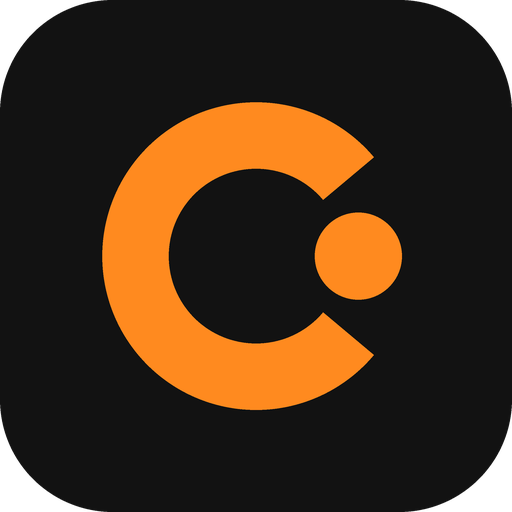

<p align="center"></p>

# Codenvi

> **Disclaimer.** Codenvi is an independent open-source project. It is not affiliated with, endorsed by, or sponsored by Anthropic, PBC. "Claude" and "Claude Code" are trademarks of Anthropic, PBC.
>
> Codenvi runs the official Claude Code CLI that you install and sign in to yourself on each PC. Codenvi never sees or stores your Claude credentials. Your use of Claude Code is governed by Anthropic's terms, and you are responsible for complying with them.
>
> Codenvi is intended for personal use on your own devices and your own server. It lets an AI agent change files and run commands on your PCs. Use it at your own risk and review its changes before merging them.
>
> Codenvi is provided "as is", without warranty of any kind, under the MIT License.

Codenvi lets one person drive Claude Code on several Windows PCs from an Android phone. Each PC has registered project folders. The phone sends a prompt to a project; the PC runs Claude Code on it, commits the result to a development branch (`codenvi-dev`) and sends the answer back. Prompts, replies, project names and commit messages are **end-to-end encrypted** with a key that only the PC and the phone hold - your server only relays ciphertext.

```
Android app ──HTTPS/WSS──▶ your VPS (nginx → Node.js server → PostgreSQL) ◀──HTTPS/WSS── Windows app ──▶ claude -p
```

- **Free and open source (MIT), for personal use.** One owner per installation: you run your own server.
- **No accounts.** You choose one password (a GitHub secret). On the phone and on every PC you type two things once, the server's host name and that password, and each app then holds its own revocable credential.
- **No open ports on your PCs.** Both apps connect outbound.
- **A compromised server can't run commands on your PCs** - it can't produce a valid encrypted prompt.

The full design is in [Project.md](Project.md).

## Getting started

You need: a small Ubuntu 24.04 VPS, a domain or subdomain pointing at it, Windows 10/11 PCs with [Git for Windows](https://git-scm.com/download/win) and Claude Code installed, and an Android phone (Android 8+).

1. **Server.** Fork the repository, then:
   - add the GitHub secrets `VPS_HOST`, `VPS_USER`, `VPS_SSH_PRIVATE_KEY` and `ENV_VARS`. `ENV_VARS` holds three lines that name your server: `CODENVI_APP_NAME` (also the database name), `CODENVI_HOST` and `CODENVI_PORT`. Nothing about your server is stored in the repository, and the keys (JWT secret, database password, the server's password) are generated for you on the first deploy. Details: [docs/self-hosting.md](docs/self-hosting.md);
   - point a DNS A record at the VPS and push to `main` with `[server]` in the commit message;
   - the two values you type in the apps are the **host name** (`CODENVI_HOST`) and the **password** (`CODENVI_ACCESS_KEY`: put your own in `ENV_VARS`, or read the generated one with `codenvi-admin password` on the VPS).

   The deploy creates its own folder, database, PM2 process and nginx site, and stops before changing anything if one of them would collide with another project on the VPS. Details: [docs/self-hosting.md](docs/self-hosting.md).
2. **PC.** Download [`windows/Codenvi.exe`](windows/Codenvi.exe) from this repository and run it. Windows SmartScreen warns because the exe is unsigned: choose *More info → Run anyway*. Read the disclaimer, enter the **host name** and **password** in *Connect to server* and pick a name.
3. **Claude Code.** Install Claude Code on the PC and sign in to it yourself, in a terminal. Codenvi only checks that `claude` is present and signed in; it never handles your Claude credentials.
4. **Encryption key.** In Codenvi press **Generate key and register this PC**.
5. **Phone.** Download [`android/Codenvi.apk`](android/Codenvi.apk) and install it (allow installing from unknown sources).
6. On the PC press **Connect a phone** and paste the string into the phone. That links the phone to the server and gives it the PC's encryption key in one step. (Or enter the same host name and password on the phone as on the PC, then add the PC's key with **Show encryption key**.)
7. On the PC, **Register project** → pick a folder. Codenvi creates the `codenvi-dev` branch. Send your first prompt from the phone.

**More PCs:** install `Codenvi.exe` on each one and enter the same host name and password. Every PC links on its own and can be revoked on its own. The phone needs each PC's encryption key once: that PC's **Show encryption key** gives a key-only string to paste into the phone. The password only links apps to the server; the encryption keys stay on your PCs and phone, so the server cannot read your messages even though it knows the password.

## What's in the repository

| Path | What |
|---|---|
| `server/` | Node.js + TypeScript + Express relay server with PostgreSQL (Drizzle): `src/`, `tests/`, `drizzle/` migrations, `deploy/deploy.sh` |
| `windows/` | WPF app; `windows/Codenvi.exe` is the built app (pairing, keys, project registration, job engine, git, tray) |
| `android/` | Jetpack Compose app; `android/Codenvi.apk` is the built app (devices, projects, chat, Multimode, voice, read aloud) |
| `shared/` | `Codenvi.Contracts`: DTOs, WebSocket envelope, crypto (C#) used by the Windows app |
| `docs/` | [protocol](docs/protocol.md), [crypto + test vectors](docs/crypto.md), [building](docs/building.md), [self-hosting](docs/self-hosting.md) |
| `.github/` | Workflows (GitHub requires this folder at the root) and the gitleaks configuration |

## Deploying changes (owner's repository)

Put tags in any commit message of a push to `main`, in any combination:

| Tag | Result |
|---|---|
| `[android]` | tests and builds the app, commits `android/Codenvi.apk` |
| `[windows]` | tests and builds the app, commits `windows/Codenvi.exe` |
| `[server]` | tests the server, then deploys database migrations and code to your VPS |

With several keywords the **server always goes first**: the apps are built only after the server deploy succeeded, and not at all if it failed. So `Release [server] [windows] [android]` in one commit is fine. A push without keywords starts nothing. Everything can also be run manually (Actions → publish → Run workflow, tick the parts you want). Secrets: `VPS_HOST`, `VPS_USER`, `VPS_SSH_PRIVATE_KEY`, `ENV_VARS`, and for the APK `ANDROID_KEYSTORE_B64` + `ANDROID_KEYSTORE_PASSWORD` ([docs/building.md](docs/building.md#android-signing)). Every APK is signed with the same key, so it installs over the previous one and the phone stays paired. Forks build and test but never sign, deploy or push binaries.

Rollback is `git revert` of the commits after the good one, then push with the tag again.

## Defaults chosen for the open questions (Project.md §15)

| Q | Default in this code | Change it by |
|---|---|---|
| Q1 Domain | A domain (`CODENVI_HOST` in `ENV_VARS`) with nginx + Let's Encrypt is required. Self-signed setups are supported by the apps through the `pin=` parameter (see self-hosting docs). | Set `CODENVI_PIN` in `ENV_VARS` |
| Q2 Tags | `[server]`, `[windows]` and `[android]` in any commit of the push. | Edit the `if:` lines in the workflows |
| Q3 Binaries | Committed as `windows/Codenvi.exe` and `android/Codenvi.apk`; the Windows workflow fails above 95 MB with a pointer to Git LFS. Each run also uploads the build as a workflow artifact. | Enable the LFS line in `windows/.gitattributes` |
| Q4 Permissions | `acceptEdits` + per-project allowed tools (`Read Edit Write Glob Grep`), `--permission-prompts none`. `bypassPermissions` needs an explicit confirmation. | Project → Settings tab on the PC |
| Q5 Copyright | `Irakli Gzirishvili` placeholder in `LICENSE` and About screens. | Replace the placeholder |
| Q6 App ID | `app.codenvi` | `android/app/build.gradle.kts` (before the first release) |

Replace `Irakli Gzirishvili` in this README, `windows/src/Codenvi.Desktop/Views/AboutWindow.xaml.cs` and `android/app/src/main/res/values/strings.xml` with your GitHub account.

## Security model in one paragraph

TLS on every hop plus AES-256-GCM per message with a 256-bit device key derived per PC (HKDF). The AAD binds each ciphertext to its device, object, direction and time, so the server can't move a prompt to another project, swap prompt and reply, or replay it under another ID; the desktop also refuses already-seen job/prompt IDs and prompts older than 24 hours. Tokens are DPAPI-protected on the PC and Keystore-wrapped on the phone. Lost phone: revoke it from the PC (Settings → Revoke) or `codenvi-admin revoke <id>` on the VPS, then **Regenerate key** on each PC. See [docs/crypto.md](docs/crypto.md).

## License

[MIT](LICENSE). Third-party packages keep their own licenses (MIT, Apache-2.0 or compatible); notices are in each app's About screen.
